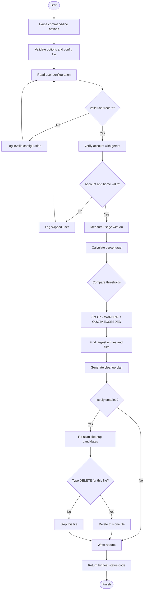
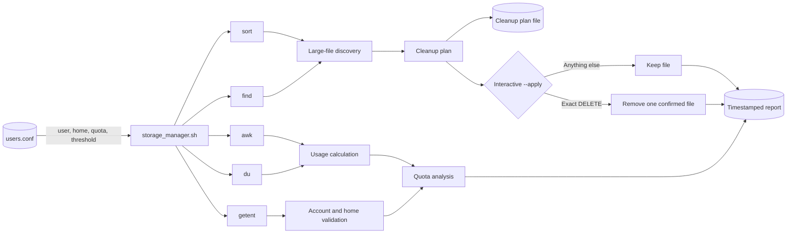
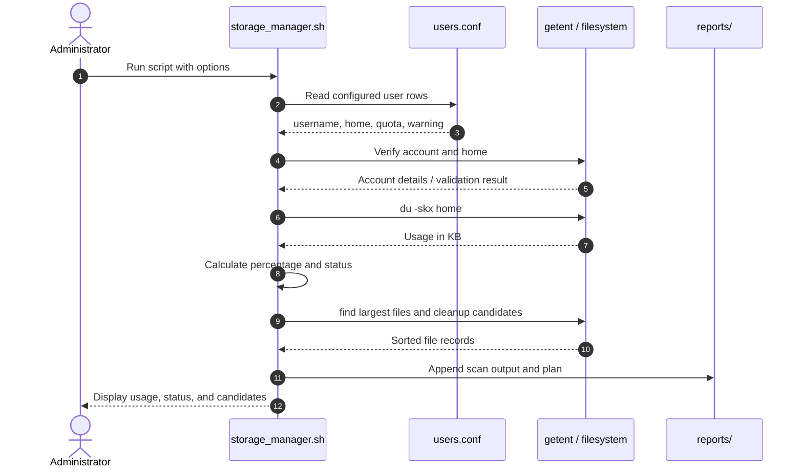
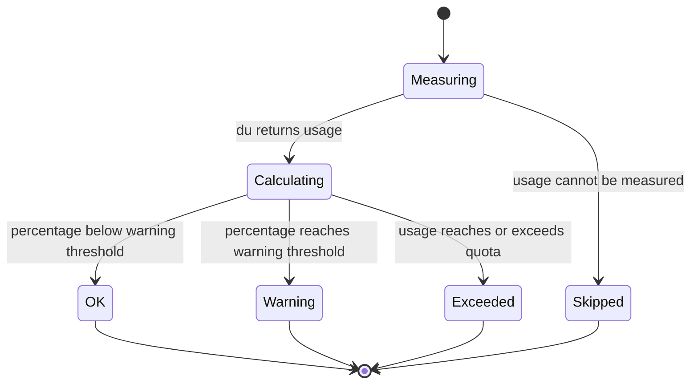
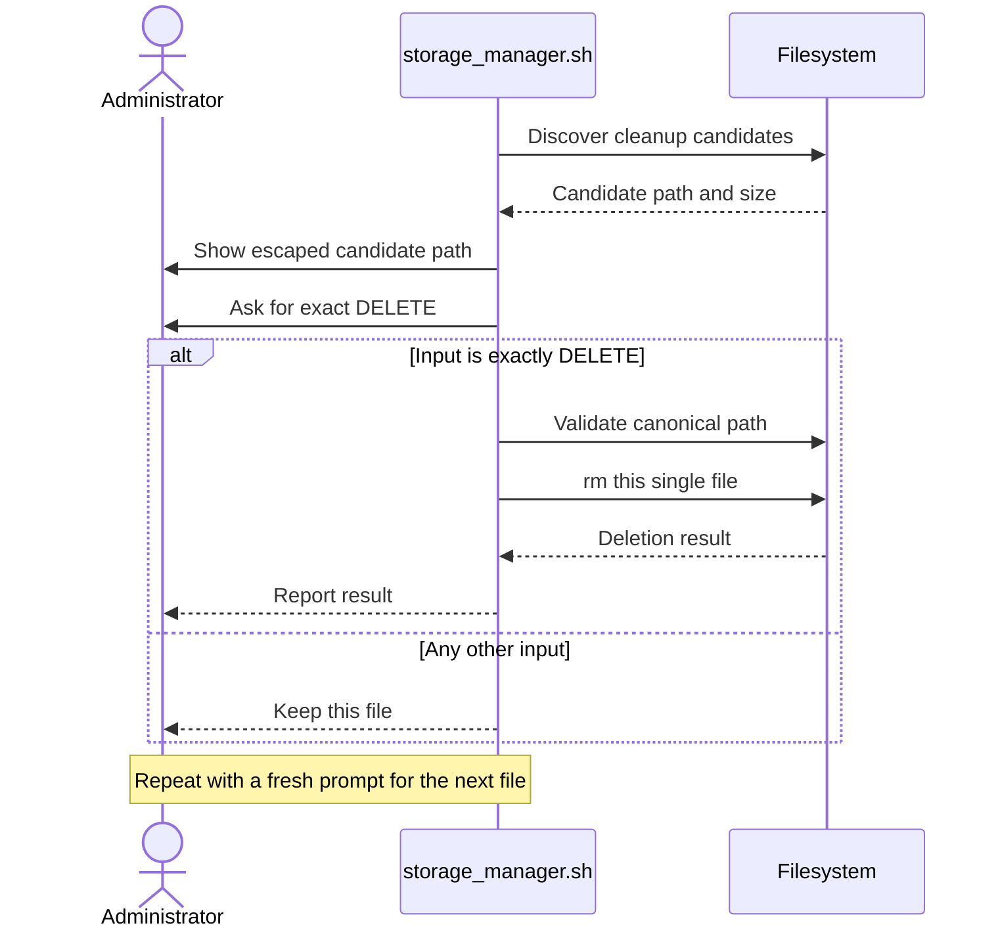
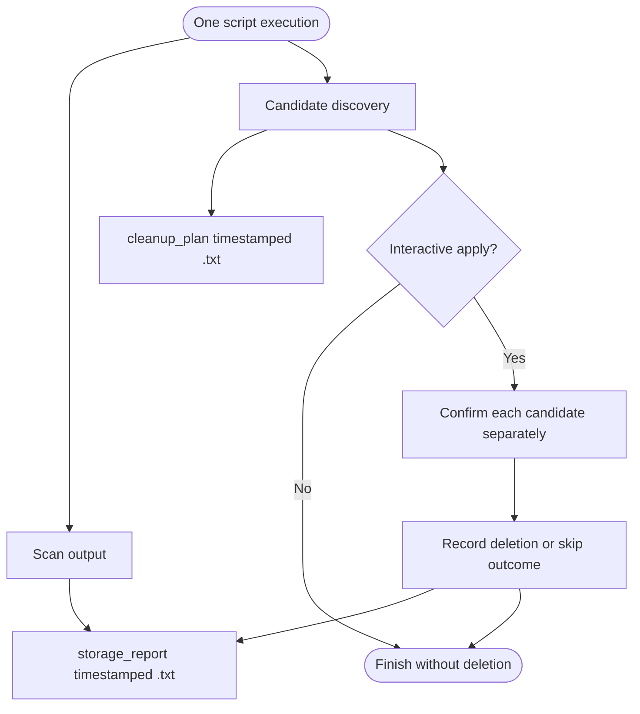

<div align="center">

# Quota-Aware User Storage Manager

**A safe, report-driven Linux storage auditing and cleanup utility built with Bash.**

Monitor user home directories · Detect quota pressure · Identify large files · Plan cleanup without accidental deletion


[Features](#-features) · [Architecture](#-how-it-works) · [Quick start](#-quick-start) · [Usage](#-usage) · [Safety](#-safety-model) · [Testing](#-testing)

</div>

---

## Overview

The **Quota-Aware User Storage Manager** is a command-line utility for Linux system administrators and lab environments. It scans configured user home directories, compares disk usage against configurable quota thresholds, highlights storage-heavy files and directories, and creates a cleanup plan.

It is designed around one principle:

> **Inspect first. Plan second. Delete only after explicit confirmation.**

The default run is non-destructive. The optional `--apply` mode still requires the operator to type `DELETE` separately for every individual file. There is no bulk-delete confirmation.

## ✨ Features

| Capability | What it does |
|---|---|
| Quota monitoring | Calculates each configured user's home-directory usage against a quota |
| Threshold alerts | Classifies usage as `OK`, `WARNING`, or `QUOTA EXCEEDED` |
| Precision | Uses integer arithmetic in tenths of a percent for threshold comparisons |
| Account validation | Checks users and registered home directories through `getent` |
| Storage discovery | Lists the largest immediate entries and largest regular files |
| Cleanup planning | Creates a dry-run list of files above a configurable size |
| Age filtering | Optionally filters cleanup candidates with `--older-than-days N` |
| Audit reports | Writes timestamped scan reports and cleanup-plan files |
| Safe deletion | Requires a separate exact `DELETE` confirmation for each candidate |
| Filename handling | Uses NUL-delimited file discovery and escaped paths in delete prompts |

## 🧭 How it works

### High-level workflow



### Component view



### Visual walkthrough: scan lifecycle

This sequence diagram shows the interaction between the operator, the Bash script, Linux account tools, filesystem utilities, and report files.



### Visual walkthrough: quota status machine



### Visual walkthrough: one-file confirmation

The confirmation is deliberately a per-file decision. A confirmation never carries over to the next candidate.



### Visual walkthrough: output artifacts



### Quota classification

The script calculates percentage usage in tenths of a percent:

```bash
pct_x10=$(( usage_kb * 1000 / (quota * 1024) ))
pct="$((pct_x10 / 10)).$((pct_x10 % 10))"

if ((pct_x10 >= 1000)); then
  status="QUOTA EXCEEDED"
elif ((pct_x10 >= warning * 10)); then
  status="WARNING"
else
  status="OK"
fi
```

This avoids rounding a value up before comparing it with a threshold. For an 80% warning threshold, 79.9% remains `OK`, while 80.0% becomes `WARNING`.

## 🧰 Technology

| Tool | Role |
|---|---|
| **Bash** | Main program, option parsing, validation, loops, and functions |
| **getent** | Account and registered-home lookup |
| **du** | Directory disk-usage measurement |
| **find** | File discovery, size filtering, age filtering |
| **sort** | Ranking files and entries |
| **awk** | Human-readable size formatting |
| **head** | Limiting displayed results |
| **realpath** | Canonical path validation before deletion |
| **tee** | Displaying scan output while writing the report |

No third-party runtime packages are required on a typical GNU/Linux installation.

## 🚀 Quick start

### 1. Clone the repository

```bash
git clone https://github.com/abhishekpasupathy/unixassigment1.git
cd unixassigment1
chmod +x storage_manager.sh
```

### 2. Check system requirements

```bash
bash --version
getent --version
find --version
```

The script expects Bash and GNU-compatible utilities, including `find` with `-printf` and `sort` with `-z`.

### 3. Configure users

Edit `config/users.conf`:

```text
# username|absolute_home_directory|quota_in_MB|warning_threshold_percent
alice|/home/alice|2048|80
bob|/home/bob|1024|75
```

Each non-comment row contains exactly four pipe-separated fields.

**Configuration rules**

- The username must match `^[A-Za-z_][A-Za-z0-9._-]*$`.
- The home directory must be an absolute path.
- The configured home must exactly match the home registered by `getent passwd`.
- Quota and warning values must be positive integers **without leading zeros**. Use `8`, not `08`.
- The warning threshold must be between 1 and 99.

Verify an account and its registered home:

```bash
getent passwd alice
```

### 4. Run a safe scan

```bash
./storage_manager.sh
```

The default run scans users, displays findings, and creates report files. It does not delete anything.

## 🖥️ Usage

### Command options

| Option | Description |
|---|---|
| `-c, --config FILE` | Use a specific configuration file |
| `-n, --top N` | Number of largest entries/files to display (default: 5) |
| `--large-file-mb N` | Minimum file size for cleanup candidates (default: 10 MB) |
| `--older-than-days N` | Include candidates matching GNU `find -mtime +N` |
| `--report-only` | Generate reports without offering deletion |
| `--apply` | Enable interactive, per-file deletion confirmation |
| `-h, --help` | Display help and exit |

### Examples

Scan with the default configuration:

```bash
./storage_manager.sh
```

Show the top 10 entries and files:

```bash
./storage_manager.sh --top 10
```

Plan cleanup for files at least 25 MB:

```bash
./storage_manager.sh --large-file-mb 25
```

Include only candidates whose modification time satisfies GNU `find -mtime +7`:

```bash
./storage_manager.sh --large-file-mb 25 --older-than-days 7
```

Use a different configuration file:

```bash
./storage_manager.sh --config ./config/lab-users.conf
```

Run in report-only mode:

```bash
./storage_manager.sh --report-only
```

Enable interactive cleanup:

```bash
./storage_manager.sh --apply
```

**Option constraints:** `--apply` requires an interactive terminal and cannot be combined with `--report-only`.

### Interactive deletion example

```text
Candidate: /home/alice/Downloads/old\\ archive.bin (250.00 MB)
Type DELETE to remove this one file; anything else skips:
```

Enter the exact uppercase word `DELETE` to remove that candidate. Press Enter with any other value to skip it. The prompt uses Bash's escaped path representation, so newline characters in filenames cannot create fake prompt lines. The actual unmodified path is used for the filesystem operation.

## 📊 Example output

The following is an illustrative scan excerpt:

```text
Quota-Aware User Storage Manager
Mode: read-only dry run

============================================================
USER: alice
HOME: /home/alice
QUOTA: 2048 MB
Usage: 1.25 GB (1280 MB)
Quota usage: 62.5%
Status: OK

Largest entries:
  800.00 MB  /home/alice/Downloads
  300.00 MB  /home/alice/Documents

Largest files (top 5):
  250.00 MB  /home/alice/Downloads/archive.zip
  120.00 MB  /home/alice/Videos/recording.mp4

Dry-run cleanup candidates (at least 10 MB):
  [PLAN ONLY] 250.00 MB  /home/alice/Downloads/archive.zip

Reports generated:
  reports/storage_report_YYYYMMDD_HHMMSS.txt
  reports/cleanup_plan_YYYYMMDD_HHMMSS.txt

No file is deleted unless --apply is used and DELETE is typed for that individual file.
```

### Status thresholds

For a configured quota of 100 MB and a warning threshold of 80%:

| Usage | Displayed percentage | Status |
|---:|---:|---|
| 79 MB | 79.0% | `OK` |
| 80 MB | 80.0% | `WARNING` |
| 99 MB | 99.0% | `WARNING` |
| 100 MB | 100.0% | `QUOTA EXCEEDED` |
| Above quota | 100.0% or higher | `QUOTA EXCEEDED` |

The actual percentage is calculated from the integer KB value returned by `du`, so filesystem allocation and directory metadata affect the measured total.

## 🗂️ Generated reports

Each execution creates timestamped files inside `reports/`:

```text
reports/
├── storage_report_YYYYMMDD_HHMMSS.txt
└── cleanup_plan_YYYYMMDD_HHMMSS.txt
```

| File | Contents |
|---|---|
| `storage_report_*.txt` | Scan output, usage, status, warnings, and deletion outcomes |
| `cleanup_plan_*.txt` | Candidate username, file size in bytes, and path |

The scan output is appended to the report as it is displayed. If `du` exits unsuccessfully, the report includes a warning that usage may be understated because some paths were unreadable.

## 🛡️ Safety model

The project deliberately separates discovery from deletion.

```text
             DEFAULT RUN
                  |
                  v
          Scan and measure
                  |
                  v
          Build cleanup plan
                  |
                  v
            STOP: no rm


            --apply RUN
                  |
                  v
          Re-discover candidates
                  |
                  v
          Display escaped path
                  |
                  v
       Type DELETE for this file?
             /           \\
           YES            NO
            |              |
            v              v
       Remove file       Keep file
            \\              /
             \\            /
              v          v
              Next candidate
```

Safeguards implemented by the script:

- **Read-only default:** a normal run never invokes file deletion.
- **One confirmation per file:** every deletion requires exact `DELETE` input.
- **Interactive terminal check:** `--apply` is rejected when standard input is not a terminal.
- **Path checks:** symlinks and paths resolving outside the configured home are rejected.
- **Regular files only:** cleanup discovery does not select directories.
- **Filesystem boundary:** scans use `-xdev` to avoid crossing filesystem boundaries.
- **Escaped prompt:** unusual filenames, including newline-containing names, are displayed safely.
- **No bulk-delete command:** confirming one candidate does not authorize another.

> **Important:** Deletion is permanent. Review the candidate path and its contents before confirming. Do not run the utility as root simply to bypass permission restrictions.

## 🧪 Testing

Use a disposable Linux virtual machine or a test system. Do not experiment with cleanup against important user data.

### Create a scratch account and sample files

```bash
sudo useradd -m -s /bin/bash qatest
HOME_DIR="$(getent passwd qatest | cut -d: -f6)"

sudo mkdir -p "$HOME_DIR/test files"
sudo fallocate -l 3M "$HOME_DIR/test files/big file.bin"
sudo fallocate -l 2M "$HOME_DIR/test files/"$'newline\\nfile.bin'
sudo chown -R qatest:qatest "$HOME_DIR"

printf 'qatest|%s|100|80\\n' "$HOME_DIR" > /tmp/quota-test.conf
```

Run a read-only test:

```bash
./storage_manager.sh --config /tmp/quota-test.conf --report-only
echo $?
```

### Suggested test matrix

| Test | Expected result |
|---|---|
| Valid account and matching home | User is scanned |
| Unknown account | User is skipped; contributes exit code 3 |
| Configured home differs from `getent` | User is skipped; contributes exit code 3 |
| Home is missing or unreadable | User is skipped; contributes exit code 3 |
| Quota/warning value is `08` | Configuration row rejected |
| Filename contains spaces | Path remains one candidate |
| Filename contains a newline | Candidate prompt displays escaped path |
| File is below size threshold | Not included in cleanup plan |
| File is older than the selected age filter | Included only if it also meets the size threshold |
| `--apply --report-only` | Argument error; no deletion |
| `--apply` without an interactive terminal | Rejected; no deletion |
| Confirmation is not exactly `DELETE` | Candidate is skipped |
| Confirmation is exactly `DELETE` | Only that individual candidate is removed |

### Threshold checks

For a 100 MB quota and an 80% warning threshold, the target usage values are:

| Measured usage from `du` | Expected percentage | Expected status | Expected exit code* |
|---:|---:|---|---:|
| 79 MB | 79.0% | `OK` | 0 |
| 80 MB | 80.0% | `WARNING` | 1 |
| 100 MB | 100.0% | `QUOTA EXCEEDED` | 2 |

\*These exit codes assume this is the only configured user and no user is skipped. The script uses the highest code encountered across all scanned users.

To get an exact measured target, compare against `du -sk "$HOME_DIR"` rather than relying only on the nominal sizes passed to `fallocate`. Filesystem block allocation and directory metadata contribute to the measured total.

### Cleanup after testing

```bash
sudo userdel -r qatest
sudo rm -f /tmp/quota-test.conf
```

## ↩️ Exit codes

The script returns the **highest status code encountered** while processing configured users:

| Code | Meaning |
|---:|---|
| `0` | All scanned users are OK |
| `1` | At least one user is at WARNING |
| `2` | At least one user has QUOTA EXCEEDED |
| `3` | At least one user was skipped because the account was not found, the home did not match, or the home was missing/unreadable |

For example, if one user is at WARNING and another is skipped, the final exit code is `3`.

## ⚠️ Limitations

- Measures configured home directories; it is not a replacement for kernel-enforced filesystem quotas.
- Inaccessible files may be omitted. A non-zero `du` result produces an understated-usage warning, but the exact missing paths and their sizes cannot be measured.
- Hard links and filesystem accounting can make apparent usage differ from quota accounting.
- Cleanup candidates are based on size and optional modification age, not file importance. The operator must decide whether removal is safe.
- **The cleanup list is generated twice in `--apply` mode, so it can differ from the plan file if files change in between.**
- Uses GNU options such as `find -printf` and `sort -z`, which are unavailable on some Unix variants.

## 📁 Repository layout

```text
unixassigment1/
│
├── config/
│   └── users.conf             # User quota configuration
│
├── reports/                   # Generated reports and cleanup plans
│
├── storage_manager.sh         # Main Bash application
│
└── README.md                  # Project documentation
```

## 🎓 Learning outcomes

| Outcome | Project application |
|---|---|
| CO1 | Linux/Unix commands and shell scripting |
| CO2 | File-system operations, filters, and pipelines |
| CO3 | Algorithms, loops, validation, and conditional logic |
| CO5 | Practical system-administration utility |
| PO2 | Analyses storage-usage problems |
| PO3 | Designs a quota-monitoring and safe-cleanup solution |
| PO5 | Uses Unix tools to implement the solution |
| SDG 9 | Supports reliable digital infrastructure |
| SDG 12 | Encourages responsible storage use and avoids unnecessary deletion |

## 👤 Author

**Abhishek Pasupathy**  
Unix Assignment — Quota-Aware User Storage Manager

---

<div align="center">

**Built for safer, clearer Linux storage administration.**

[Back to top](#quota-aware-user-storage-manager)

</div>
